# Admin and token credits — preview QA

Preview Worker: https://monitor-pangan-support-preview.naufaldi-rafif.workers.dev

Checked 2026-10-06, while the clock was inside the peak window (06:00–10:00 UTC). The Worker is `monitor-pangan-support-preview`, version `4a5294cc-0af8-49ef-a194-56567a6302d0`, on D1 `astra-cs-preview` (`defa7c7a-0c44-4f55-b7a9-16f22b5eeacf`). Production `monitor-pangan-support` and D1 `monitor-pangan-handoff` were not deployed or migrated.

Demo started at 50,000 tokens (50 credits). Screenshots are 1280 pixels wide, in `docs/qa/admin/`.

| # | Check | Result |
| --- | --- | --- |
| 1 | A price answer deducts exactly its total tokens, and the usage row matches the ledger row | ✅ |
| 2 | Refusal, claim, and 402 cost 0 tokens and do not call the model | ✅ |
| 3 | A balance under 2 credits returns 402 and is logged as outcome 402 | ✅ |
| 4 | Dashboard totals match D1: used tokens, earned = used × Rp100, margin = earned − cost | ✅ |
| 5 | A peak-hour reply costs 2× the off-peak rate and charges the same credits | ✅ |
| 6 | `/admin` without the key returns 401, and the key is not in any served asset | ✅ |
| 7 | A fake top-up adds the exact credits plus a ledger row. A new tenant works via `x-tenant-id` | ✅ |
| 8 | The pending-handoff list matches D1 | ✅ |
| 9 | Bilingual guardrails, handoffs, and `cost:estimate` still work. Existing tests pass | ✅ |

## 1. Three price answers

Each reply deducted its total tokens. The ledger `usage` row is the same count, negative, and `chat_ref` is the request id. Reasoning tokens come from `completion_tokens_details.reasoning_tokens`. All three were during peak (`peak = 1`).

| UTC time | Prompt | Completion | Reasoning | Total | Charged | USD | IDR |
| --- | --- | --- | --- | --- | --- | --- | --- |
| 2026-10-06T08:44:32.256Z | 126 | 560 | 526 | 686 | 686 | 0.00067668 | 11 |
| 2026-10-06T08:44:54.087Z | 116 | 729 | 692 | 845 | 845 | 0.00086715 | 14 |
| 2026-10-06T08:45:01.450Z | 129 | 343 | 303 | 472 | 472 | 0.00042929 | 7 |

Demo balance moved 50,000 → 49,314 → 48,469 → 47,997. Questions were beras in Jakarta, rice in Aceh, and cabai merah in Aceh.

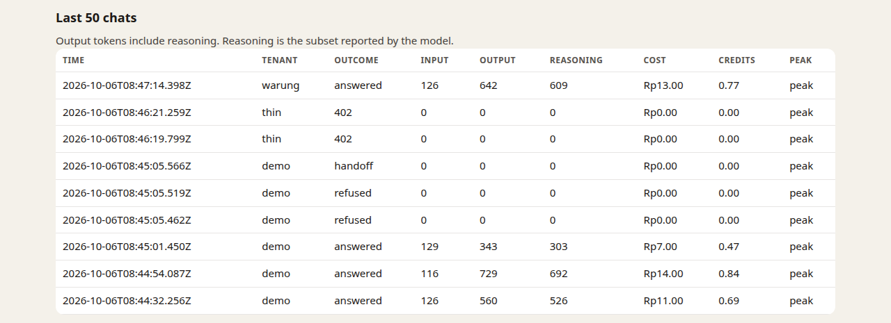

The shot was taken after the later warung answer and the thin 402 rows, so those sit above the three spot-checks.

## 2. Free paths

| UTC time | What | Outcome | Tokens | Credits charged | Balance after |
| --- | --- | --- | --- | --- | --- |
| 2026-10-06T08:45:05.462Z | "How do I cook rice?" | refusal | 0 | 0 | 47,997 |
| 2026-10-06T08:45:05.519Z | "Beras medium enaknya dimasak dan dimakan gimana?" | refusal | 0 | 0 | 47,997 |
| 2026-10-06T08:45:05.566Z | "Di pasar dekat rumah saya beras cuma 10 ribu" | handoff | 0 | 0 | 47,997 |
| 2026-10-06T08:46:19.799Z | thin, "harga beras di Jakarta" | 402 | 0 | 0 | 1,000 |
| 2026-10-06T08:46:21.259Z | thin, same question in the chat page | 402 | 0 | 0 | 1,000 |

None of these rows has a `usage` ledger debit. A model call would have returned a non-zero total, as the price answers did.

## 3. Under 2 credits

`thin` was created with 1 credit (1,000 tokens). Both price questions returned HTTP 402, outcome `402`, 0 tokens, and the balance stayed 1,000.

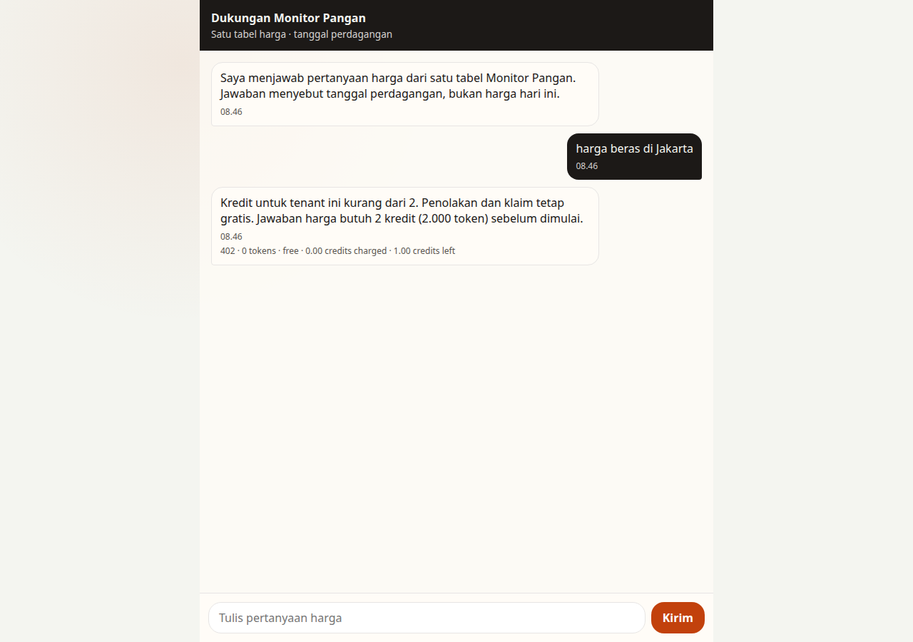

## 4. Reconciliation

After the three demo answers, the warung answer (768 tokens), the free rows, and the Rp500 top-up:

| | D1 | Shown on `/admin` |
| --- | --- | --- |
| Tokens | 2,771 | 2,771 |
| Charged tokens | 2,771 | credits used 2.77 |
| Real cost | Rp45 | Rp45.00 |
| Earned | 2,771 × Rp100 / 1,000 = Rp277.10 | Rp277.10 |
| Margin | 277.10 − 45 = Rp232.10 (83.8%) | Rp232.10 · 83.8% |
| Cash in | topup sen 50,000 = Rp500 | Rp500.00 |
| Ledger gap | sum of balances − sum of deltas = 0 | |

`GET /credits` with the workshop key returned tokens and credits for demo (52,997 tokens), thin (1,000), and warung (9,232). Without the key it returned 401.

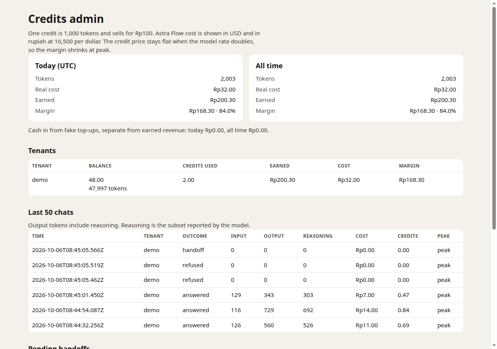

## 5. Peak multiplier

The three price answers above match `estimateCost(usage, true)` exactly, including IDR. The credit charge is the token total, same as it would be off-peak. Unit tests lock the 180/60 case at $0.00006006 / Rp1 off-peak and $0.00012012 / Rp2 at peak, with the same 240-token charge.

USD is `round(2 × unrounded off-peak USD, 8 decimals)`. Doubling the already-rounded off-peak USD can differ by 0.00000001 (the 116/729 reply: 0.00086716 vs 0.00086715). IDR is rounded after that, so 2 × the rounded off-peak rupiah can be Rp1 away (the 129/343 reply: off-peak would round to Rp4, and Rp4 × 2 is Rp8, while the peak price is Rp7).

## 6. Admin auth

`GET /admin` with no key returned HTTP 401 and `WWW-Authenticate: Basic realm="admin"`. The body is `Authentication required`. Headless Chrome leaves that document empty because of the Basic challenge, so the screenshot is that live status and body rendered at 1280 pixels wide.

The key was absent from `/`, `/draft.js`, `/chat.css`, and the authenticated `/admin` HTML, and it is not in the repo.

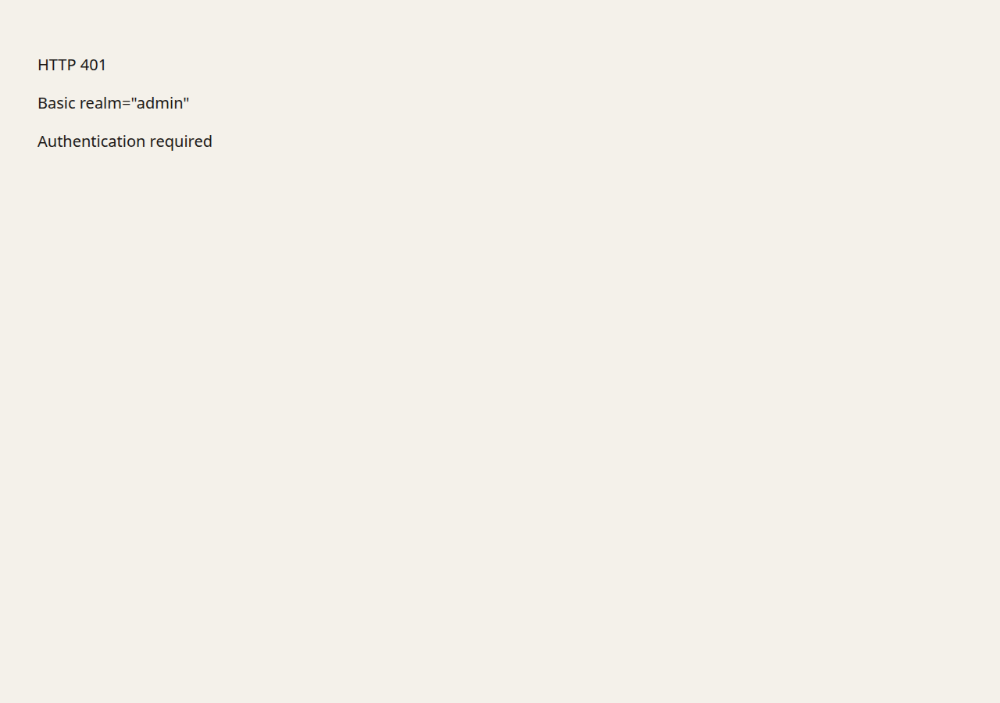

## 7. Top-up and a new tenant

Before the top-up, demo had 47,997 tokens. The form added 5 credits. The ledger row is `topup_fake`, `delta_tokens` 5,000, `idr_amount` 50,000 sen (Rp500). Demo balance became 52,997.

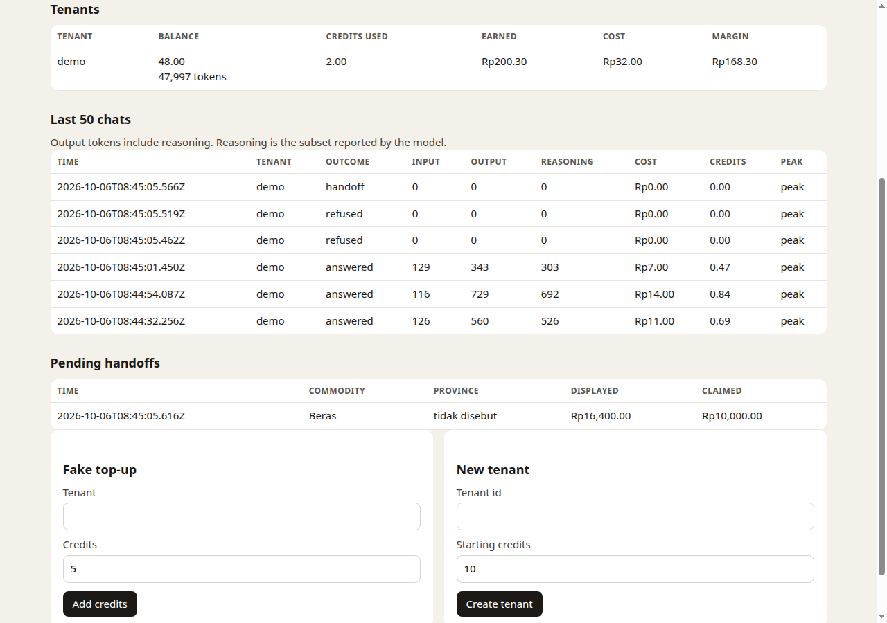

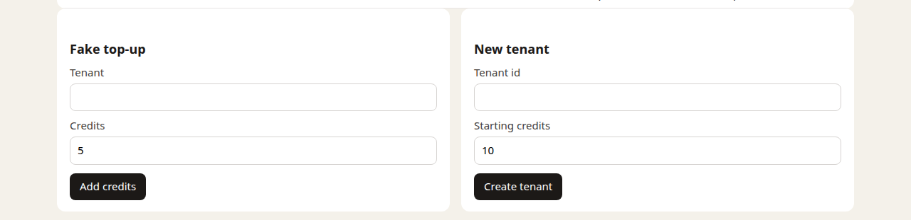

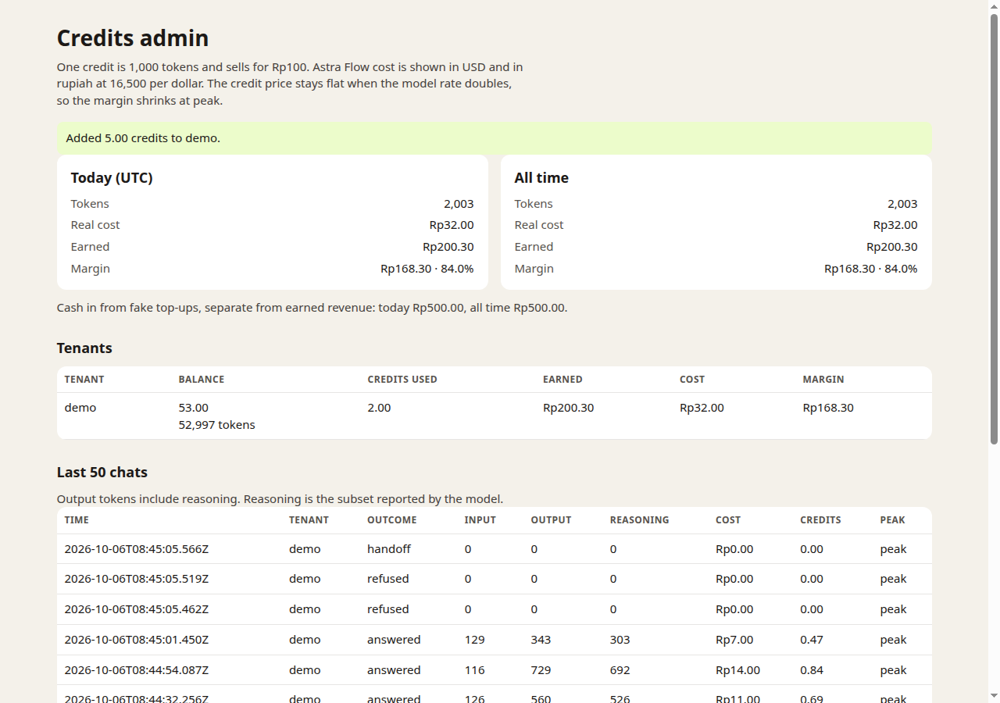

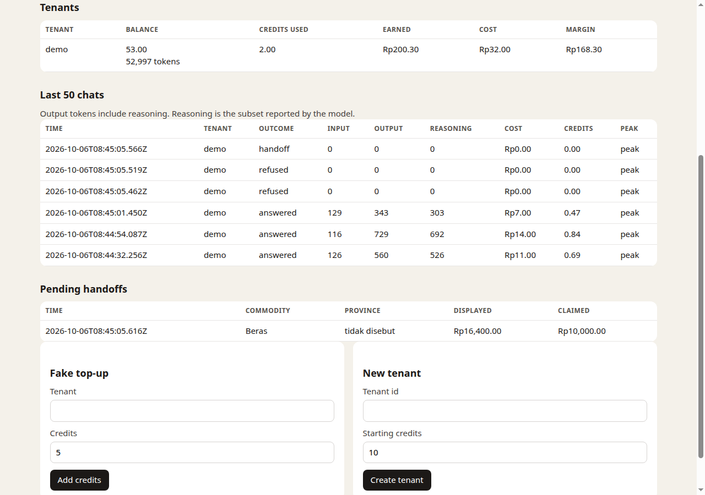

`warung` was created with 10 credits (10,000 tokens) and answered "harga beras di Jakarta" on the next request: 2026-10-06T08:47:14.398Z, 768 tokens charged, balance 9,232.

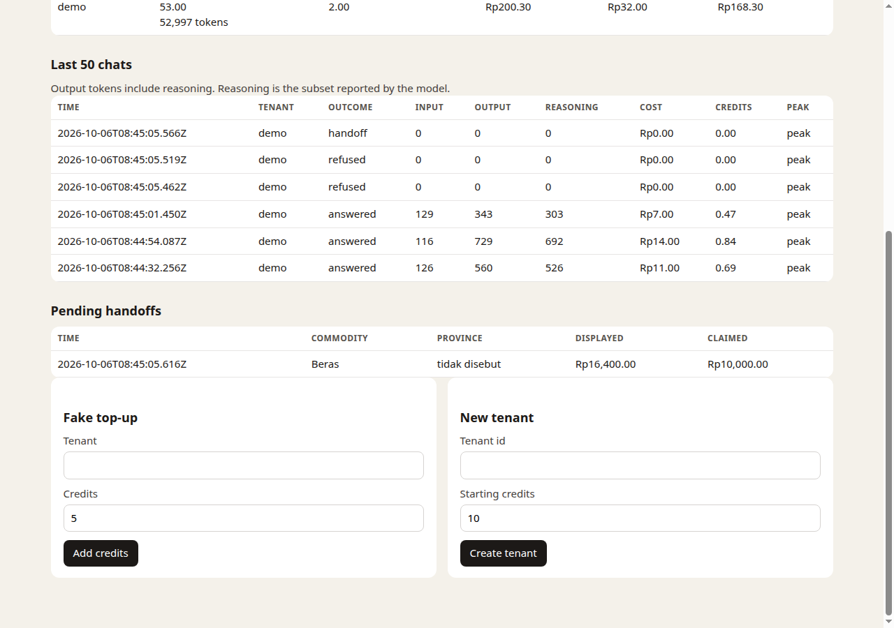

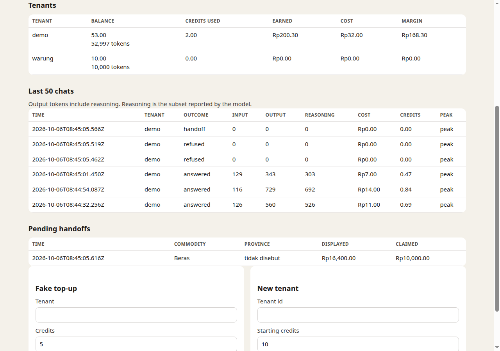

## 8. Pending handoffs

D1 has one row, and the page shows the same row.

| Created (UTC) | Commodity | Province | Displayed | Claimed |
| --- | --- | --- | --- | --- |
| 2026-10-06T08:45:05.616Z | Beras | tidak disebut | 16,400 | 10,000 |

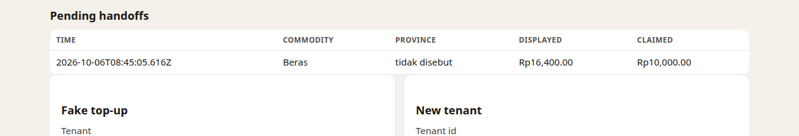

## 9. Regression

- English and Indonesian cooking questions were refused with 0 tokens (section 2).
- The casual claim was stored as a handoff and did not call the model (sections 2 and 8).
- `npm run cost:estimate -- --prompt 180 --completion 60 --share 0.4` still prints the off-peak monthly table.
- `npm test`: 6 files, 68 passed.
- `npm run test:exercise`: the identity-gate exercise still fails on purpose. The wording payload still contains the visitor name and phone.

## Notes

No pricing rule had to be changed. Two display details are worth knowing:

- Credits on screen are tokens / 1,000 to two decimals, so 686 tokens is shown as 0.69 credits. The stored charge and the ledger stay 686.
- `GET /credits` returns `credits` as a JSON number, so 52,997 tokens is `53` rather than `53.00`. The `tokens` field is the exact integer. The admin page shows both `53.00` and `52,997 tokens`.
