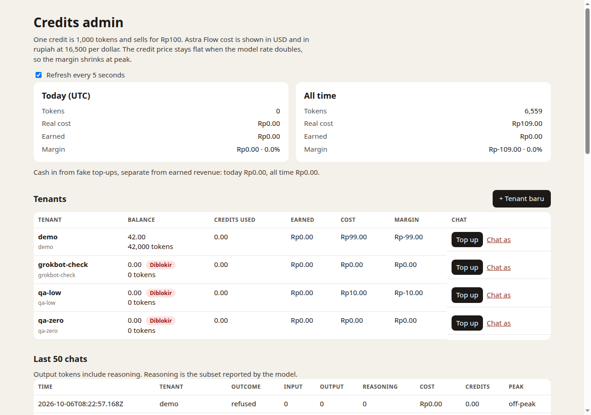
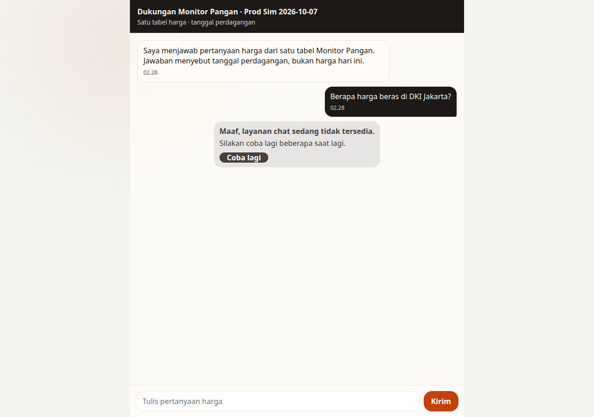
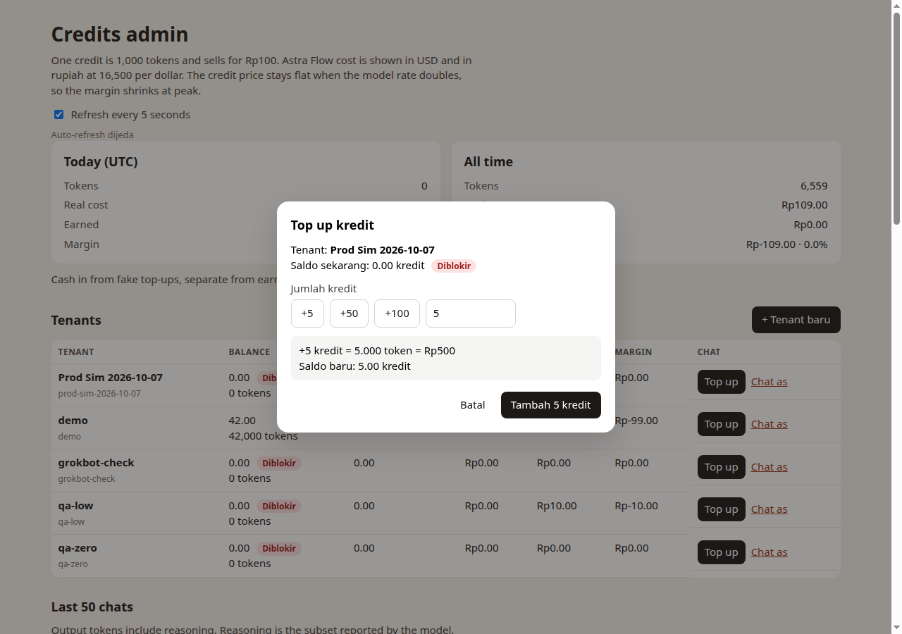
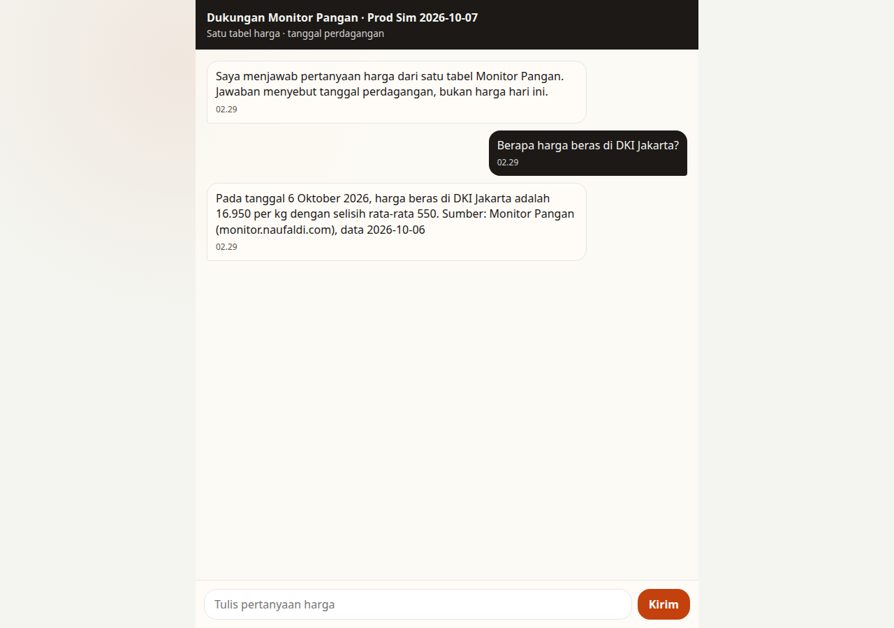
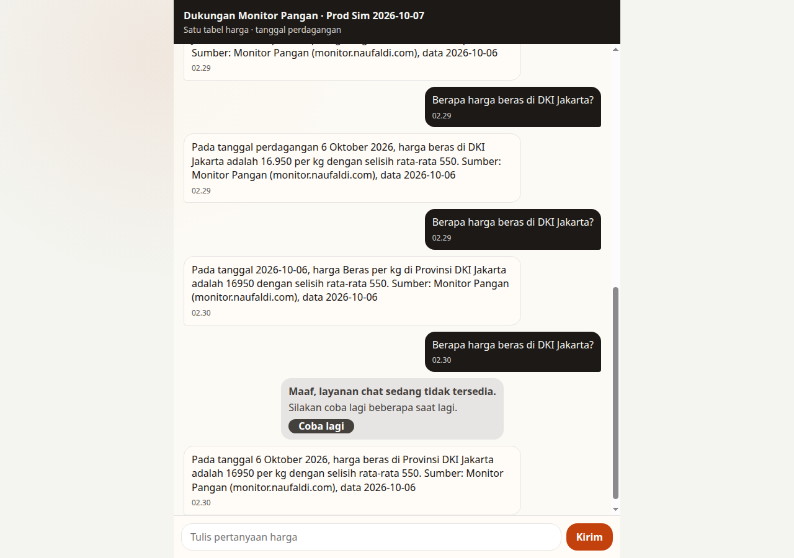

# Production deploy — admin login and credit loop

Production: https://monitor-pangan-support.naufaldi-rafif.workers.dev

Checked 2026-10-07 from 02:28 to 02:30 UTC, inside the peak window (01:00–04:00 UTC). Every call in this run has `peak = 1`.

Worker `monitor-pangan-support`, version `2d88ebab-8e74-4650-bb86-f556eca1b504`. D1 `monitor-pangan-handoff` (`fc312fce-8abd-446a-9dfd-7cc2d0015e07`). Migrations `0004_credit_ledger.sql`, `0005_tenant_name.sql`, and `0006_admins.sql` were applied on that database before the deploy. The seeded row is username `admin`, created `2026-10-07T00:00:00.000Z`. Secrets `ASTRAFLOW_API_KEY` and `WORKSHOP_KEY` were already set and were left in place.

`/admin` is HTTP Basic against the `admins` table. The workshop login is username `admin`, password `admin`. `GET /credits` and `GET /handoff` still use `WORKSHOP_KEY`. The main commit is `68c0af5941f27f44d4637c47abde45ad54671f3c`.

Screenshots are 1280 pixels wide, in `docs/qa/prod/`.

`npm test` on this main: 6 files, 72 passed. The identity-gate exercise still fails on purpose.

## Acceptance

| # | Check | Result |
| --- | --- | --- |
| 1 | `/admin` with no credentials is 401. Body: `Login with your admin account`. | ✅ |
| 2 | Basic `admin` / `admin` returns 200 and the dashboard. The HTML has no password hash and no salt. | ✅ |
| 3 | Wrong password is 401. | ✅ |
| 4 | `Prod Sim 2026-10-07` (`prod-sim-2026-10-07`) created at 0 with `Diblokir`. | ✅ |
| 5 | Chat as that tenant shows the unavailable bubble. Customer HTML/JS has no billing words. | ✅ |
| 6 | Top up +5 preview is `+5 kredit = 5.000 token = Rp500` and `Saldo baru: 5.00 kredit`. Banner names the tenant and `5.00`. | ✅ |
| 7 | Two price answers. Admin moved from `4.25` / `4,254 tokens` to `3.73` / `3,726 tokens` in 4.5 s. | ✅ |
| 8 | Under 2 credits the next send is the unavailable bubble, 0 tokens, `wording_ms` 0. Balance stayed 1,259. | ✅ |
| 9 | Another +5, then `Coba lagi`, returns a real answer (514 tokens charged). | ✅ |
| 10 | Live `/`, `/draft.js`, and `/chat.css` have no token, kredit, credit, cost, or `Sisa kredit`. | ✅ |
| 11 | This tenant's balance equals its ledger sum (5,745). | ✅ |

## Login

No `Authorization` header: 401, `Login with your admin account`. Password `wrong`: 401. `admin` / `admin`: 200, `Credits admin`.

## New tenant at zero

The dialog created `Prod Sim 2026-10-07`. The banner was `Tenant "Prod Sim 2026-10-07" dibuat · saldo 0 kredit.` The header on the chat page is `Dukungan Monitor Pangan · Prod Sim 2026-10-07`.

The first send at `2026-10-07T02:28:05.547Z` is outcome `402`, 0 tokens, `wording_ms` 0. `price_read_ms` is 1,851, so the price table was read and Astra Flow was not called.

## Top up +5

The button read `Tambah 5 kredit`. After submit the banner was `+5 kredit ditambahkan ke Prod Sim 2026-10-07. Saldo baru: 5.00 kredit.`

## Answers and the drain

Six peak price answers took the 5,000 tokens under the 2,000-token gate. Reasoning is included, so this was six answers. The gate was not changed.

| UTC time | Prompt | Completion | Reasoning | Total charged | Balance after |
| --- | --- | --- | --- | --- | --- |
| 2026-10-07T02:29:18.153Z | 126 | 620 | 586 | 746 | 4,254 |
| 2026-10-07T02:29:28.018Z | 126 | 402 | 363 | 528 | 3,726 |
| 2026-10-07T02:29:40.061Z | 126 | 423 | 391 | 549 | 3,177 |
| 2026-10-07T02:29:46.296Z | 126 | 538 | 500 | 664 | 2,513 |
| 2026-10-07T02:29:53.348Z | 126 | 374 | 337 | 500 | 2,013 |
| 2026-10-07T02:29:58.363Z | 126 | 628 | 592 | 754 | 1,259 |

`4,254 − 528 = 3,726`. The open admin page showed that drop in 4,456 ms.

The next send at `2026-10-07T02:30:06.390Z` is outcome `402`, 0 tokens, `wording_ms` 0, `price_read_ms` 76. The balance stayed 1,259. The bubble was the same unavailable copy and `Coba lagi`.

A second +5 then `Coba lagi` answered at `2026-10-07T02:30:08.661Z`: 126 / 388 / 353 / 514 charged. Balance 5,745, matching the ledger sum.

## Other tenants

`demo` stayed at 42,000 tokens. `grokbot-check`, `qa-low`, and `qa-zero` stayed at 0.
