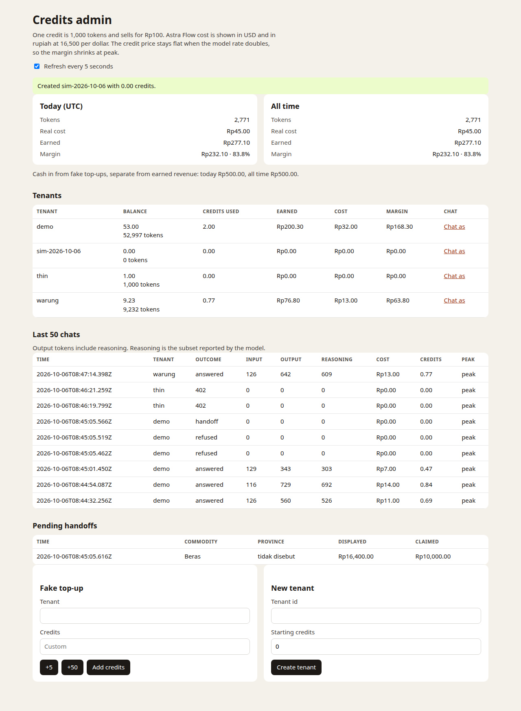
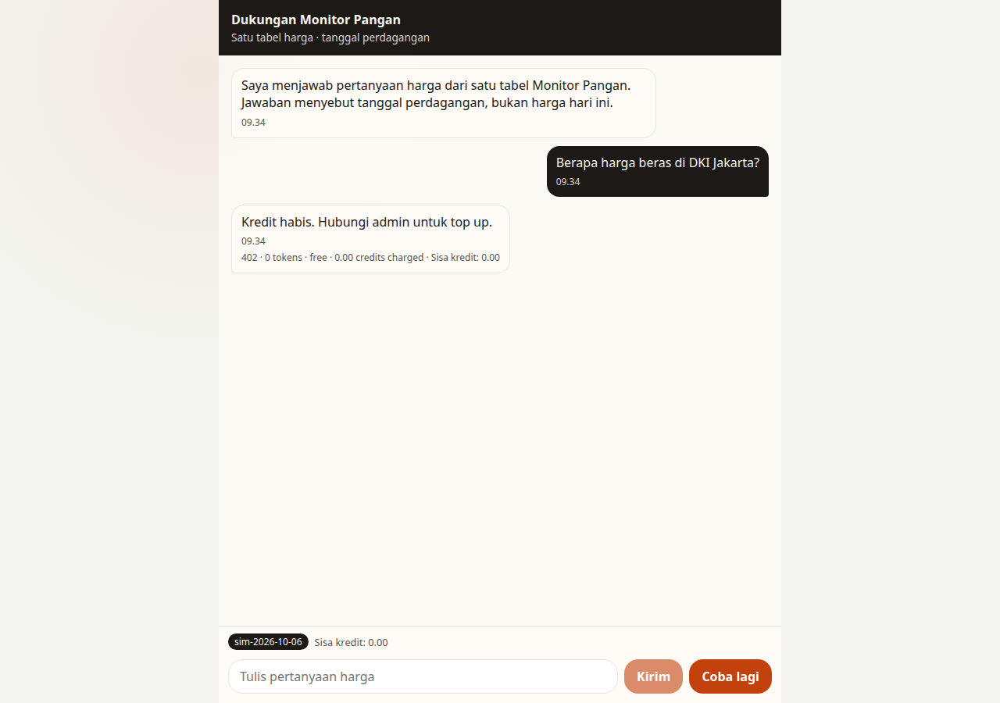
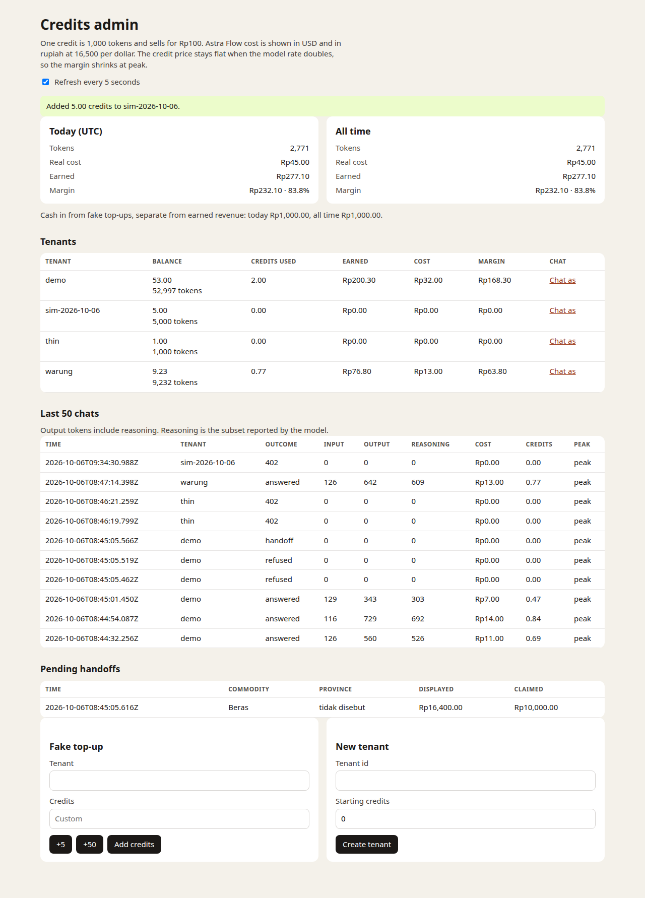
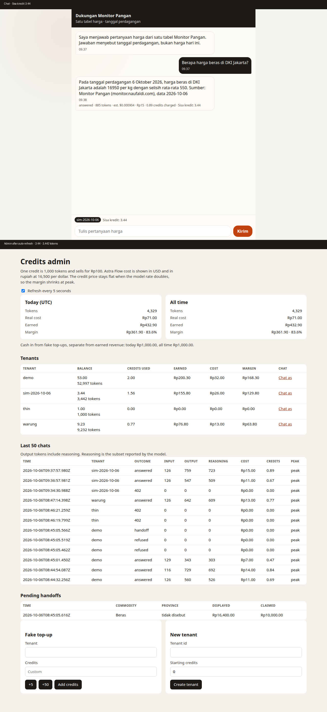
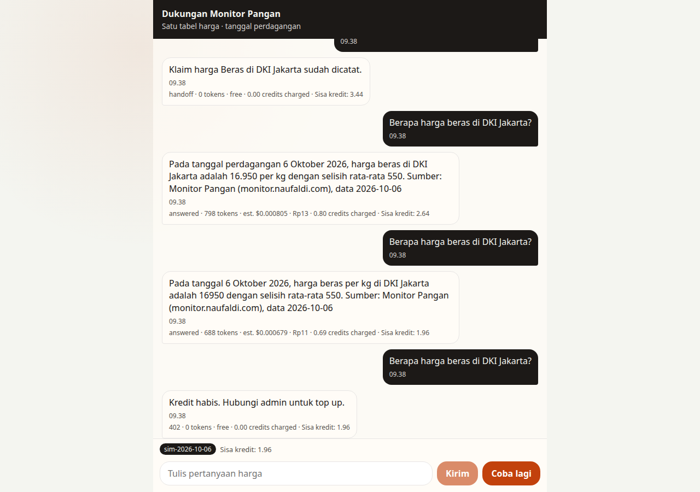
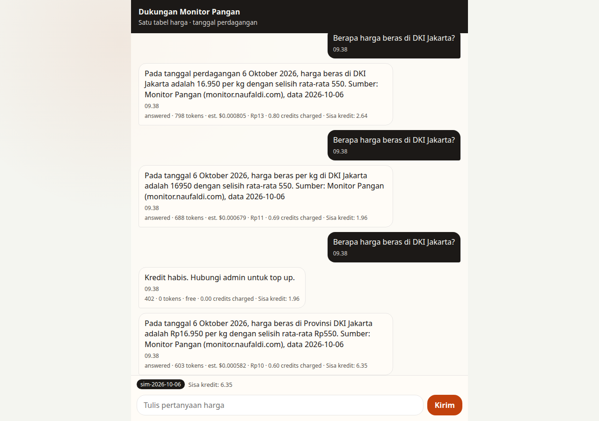
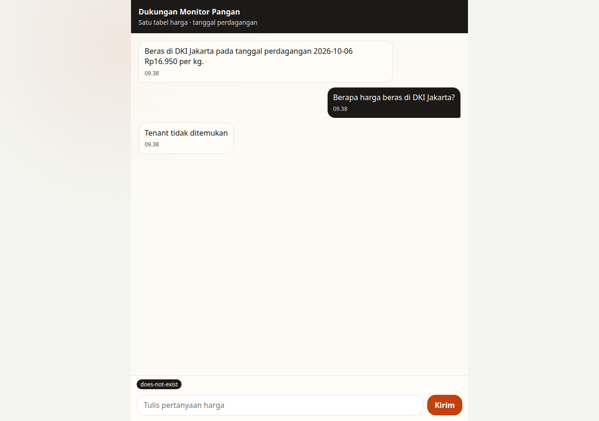

# Credit-loop simulation — preview QA

Preview Worker: https://monitor-pangan-support-preview.naufaldi-rafif.workers.dev

Checked 2026-10-06 from 09:34 to 09:39 UTC, inside the peak window (06:00–10:00 UTC). The Worker is `monitor-pangan-support-preview`, version `9e428293-b341-4a65-98ec-fb5900b8c22b`, on D1 `astra-cs-preview` (`defa7c7a-0c44-4f55-b7a9-16f22b5eeacf`). Production `monitor-pangan-support` and D1 `monitor-pangan-handoff` were not deployed or migrated.

The chat surface is the existing page (`web/index.html`). `?tenant=sim-2026-10-06` sends `x-tenant-id`. Screenshots are 1280 pixels wide, in `docs/qa/sim/`.

Balances recorded before any sim write: demo 52,997 tokens, thin 1,000, warung 9,232.

| # | Check | Result |
| --- | --- | --- |
| 1 | Create `sim-2026-10-06` at 0. Chat as opens that tenant, and the chip matches | ✅ |
| 2 | A message at 0 credits returns the friendly 402, logs 0 tokens, and does not call Astra Flow | ✅ |
| 3 | +5 shows 5.00 and a `topup_fake` ledger row | ✅ |
| 4 | Each price answer drops the admin balance by that reply's total tokens. Sisa kredit matches to 2 decimals | ✅ |
| 5 | A refusal and a claim leave the balance unchanged | ✅ |
| 6 | Under 2.00 credits the next message is 402, with no model call, and the balance stays non-negative | ✅ |
| 7 | Another +5 lets the next message through, and it is charged | ✅ |
| 8 | The ledger sum equals the balance. demo, thin, and warung are unchanged | ✅ |
| 9 | An unknown `?tenant=` says the tenant was not found, creates nothing, and makes no model call | ✅ |

## 1. New tenant at zero

Created from `/admin` with starting credits 0. The notice read "Created sim-2026-10-06 with 0.00 credits." The row showed `0.00` and `0 tokens`, and **Chat as** points at `/?tenant=sim-2026-10-06`.

The ledger grant is 0 tokens at `2026-10-06T09:34:29.538Z`.

The chat chip reads `sim-2026-10-06`.

## 2. Friendly 402 at zero

`2026-10-06T09:34:30.988Z`. Outcome `402`, error `out_of_credits`, prompt/completion/reasoning/total/charged all 0. `wording_ms` is 0, so Astra Flow was not called. `price_read_ms` is 1,095: the price table was read, which is allowed. The page showed "Kredit habis. Hubungi admin untuk top up." and **Coba lagi**, with Sisa kredit `0.00`. The composer stayed disabled.

## 3. Top up +5

Preset **+5** at `2026-10-06T09:34:33.573Z`. Ledger `topup_fake` delta `5,000` tokens, `idr_amount` 50,000 sen (Rp500). Admin balance `5.00` and `5,000 tokens`.

## 4. Token drops match Sisa kredit

Four price answers were charged from that 5.00 before the balance fell under 2.00. Real replies were 673–885 tokens, reasoning included, so this took four answers rather than about three. The 2,000-token gate was not changed.

| UTC time | Prompt | Completion | Reasoning | Total charged | Balance after | Credits on screen |
| --- | --- | --- | --- | --- | --- | --- |
| 2026-10-06T09:36:57.981Z | 126 | 547 | 509 | 673 | 4,327 | 4.33 |
| 2026-10-06T09:37:57.980Z | 126 | 759 | 723 | 885 | 3,442 | 3.44 |
| 2026-10-06T09:38:21.731Z | 126 | 672 | 635 | 798 | 2,644 | 2.64 |
| 2026-10-06T09:38:34.861Z | 126 | 562 | 529 | 688 | 1,956 | 1.96 |

Each `usage` ledger delta is the same integer, negative. All four are peak (`peak = 1`).

The pair below is the second answer. Admin showed `4.33` / `4,327 tokens` before it. The chat line was `Sisa kredit: 3.44`. The admin tab, left open with refresh every 5 seconds, then showed `3.44` / `3,442 tokens` on its own. `4,327 − 885 = 3,442`.

Credits on screen are tokens / 1,000 to two decimals. 885 tokens is shown as 0.89 credits charged, and the stored deduction stays 885.

## 5. Refusal and claim are free

Both ran while the balance was 3,442, between the 885-token answer and the 798-token answer.

| UTC time | What | Outcome | Tokens | Balance |
| --- | --- | --- | --- | --- |
| 2026-10-06T09:38:17.827Z | "How do I cook rice?" | refusal | 0 | 3,442 |
| 2026-10-06T09:38:19.280Z | "Di pasar dekat rumah saya beras cuma 10 ribu" | handoff | 0 | 3,442 |

`wording_ms` is 0 on both. The chat kept `Sisa kredit: 3.44`.

## 6. Blocked under 2.00

After the 688-token answer the balance was 1,956 tokens (1.96 credits), under the 2,000-token gate. The next message at `2026-10-06T09:38:44.947Z` is outcome `402`, 0 tokens, `wording_ms` 0, `price_read_ms` 57. The balance stayed 1,956. It did not go negative.

The page showed "Kredit habis. Hubungi admin untuk top up.", Sisa kredit `1.96`, and **Coba lagi**. Send stayed disabled.

## 7. Top up again, then Coba lagi

Second **+5** at `2026-10-06T09:38:45.459Z` (`topup_fake` +5,000). The chat tab was not reloaded. **Coba lagi** resent the blocked question and got an answer at `2026-10-06T09:38:46.033Z`: 126 prompt, 477 completion, 441 reasoning, 603 charged. Balance `6,956 − 603 = 6,353` (6.35 on screen). The composer unlocked.

## 8. Books and the other tenants

`sim-2026-10-06` balance `6,353` equals `SUM(delta_tokens)`. The global ledger gap is 0.

| Tenant | Before | After |
| --- | --- | --- |
| demo | 52,997 | 52,997 |
| thin | 1,000 | 1,000 |
| warung | 9,232 | 9,232 |
| sim-2026-10-06 | (created at 0) | 6,353 |

## 9. Unknown tenant

`/?tenant=does-not-exist` shows the chip `does-not-exist` and the reply "Tenant tidak ditemukan". Sisa kredit stays the placeholder. Send stays enabled. No `tenant_credit` row, and no `request_usage` row.

An English "What's the price of rice?" to the same id returned HTTP 404 `{ reply: "Tenant not found", outcome: "refusal" }` and did not call the model.

## Tests

- `npm test`: 6 files, 70 passed
- `npm run test:exercise`: identity-gate still fails on purpose
- `npm run cost:estimate -- --prompt 180 --completion 60 --share 0.4` still prints the off-peak table

The preview `WORKSHOP_KEY` used for this pass was deleted from the runner after the checks. Set a new one with `npx wrangler secret put WORKSHOP_KEY -c wrangler.preview.jsonc` before the Friday demo.
