# Admin dialogs and customer chat — preview QA

Preview: https://monitor-pangan-support-preview.naufaldi-rafif.workers.dev

Checked 2026-10-06 from 09:59 to 10:06 UTC, after the peak window (peak is 06:00–10:00 UTC). Every Astra Flow call in this run has `peak = 0`.

Worker `monitor-pangan-support-preview`, D1 `astra-cs-preview` (`defa7c7a-0c44-4f55-b7a9-16f22b5eeacf`). Code upload `2247b15a-0005-4504-b1f6-feae00fcbe97` (09:55:21Z). The version serving traffic after the secret update is `f5876882-fdd0-41c9-8d71-d05fd3b0b8bd` (09:55:26Z). Migration `0005_tenant_name.sql` is applied on the preview database only. Production `monitor-pangan-support` and D1 `monitor-pangan-handoff` were not deployed or migrated.

Screenshots are 1280 pixels wide, in `docs/qa/ui/`. The spec is `docs/ui-spec-admin-credits.md`.

`npm test`: 6 files, 71 passed. The identity-gate exercise still fails on purpose (the wording payload still contains "Budi" and `081234567890`). `npm test` does not run `test/exercise/**`.

## Acceptance

| # | Check | Result |
| --- | --- | --- |
| 1 | Each row has `Top up`. No standalone top-up form. | ✅ |
| 2 | `+50` on a tenant at 1.20 shows `+50 kredit = 50.000 token = Rp5.000`, `Saldo baru: 51.20 kredit`, button `Tambah 50 kredit`. | ✅ |
| 3 | Custom `0`, `-3`, `2.5`, empty, and `10001` show the inline error and a disabled button. Crafted POSTs return the same errors. | ✅ |
| 4 | A double submit with one idempotency key credits once. | ✅ |
| 5 | Green banner names the tenant and the new balance. The row is highlighted. Refresh does not submit again. | ✅ |
| 6 | Dialog open for 16 s does not reload. `Auto-refresh dijeda` is visible. After close, refresh resumes. | ✅ |
| 7 | Empty name and a duplicate name error. A valid name at 0 credits creates a top row at 0 with `Diblokir`. | ✅ |
| 8 | Zero tenants shows `Belum ada tenant.` and a create button. | ✅ |
| 9 | Under 2 credits `Diblokir`, 2–10 `Hampir habis`, above 10 no badge. | ✅ |
| 10 | A normal reply shows no token, cost, kredit, credit, or `Sisa kredit`. | ✅ |
| 11 | Header is `Dukungan Monitor Pangan · Warung Dialog`, with no "tenant" label and no id. | ✅ |
| 12 | Under 2 credits the grey bubble is the unavailable copy plus `Coba lagi`, with no billing words. | ✅ |
| 13 | After a top-up, `Coba lagi` gets a real answer, and admin shows the balance drop within about 5 s. | ✅ |

## 1. Top up is a row button

The tenants table has a `Top up` button and a `Chat as` link on every row. The page source from `renderAdmin` has no `<form id="topup">`. The unit test asserts that.

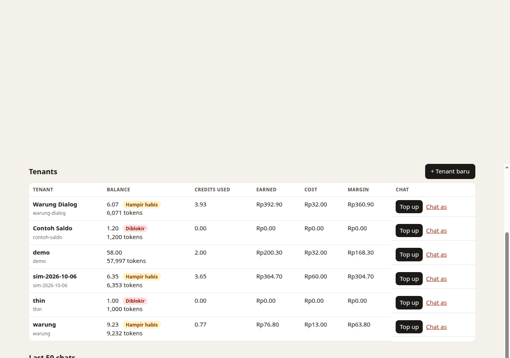

## 2. Live preview for +50

`Contoh Saldo` (`contoh-saldo`) was created through the dialog at 0 credits. The dialog only accepts whole credits, so 1.20 credits (1,200 tokens) cannot be entered there. After create, the preview database balance and the grant ledger row were set to 1,200 tokens so the books still match. That fixture is only so the screenshot can show `Saldo baru: 51.20 kredit`.

The dialog then read:

`+50 kredit = 50.000 token = Rp5.000`
`Saldo baru: 51.20 kredit`

The button label was `Tambah 50 kredit`. This +50 was not submitted.

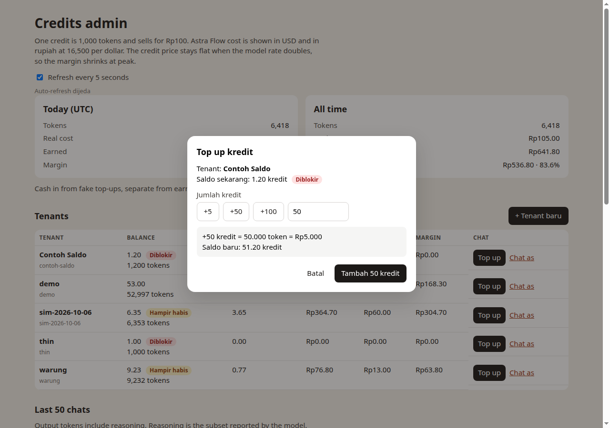

## 3. Validation

Typing `2.5` showed `Jumlah harus bilangan bulat lebih dari 0.` and the confirm button was disabled (`disabled === true`).

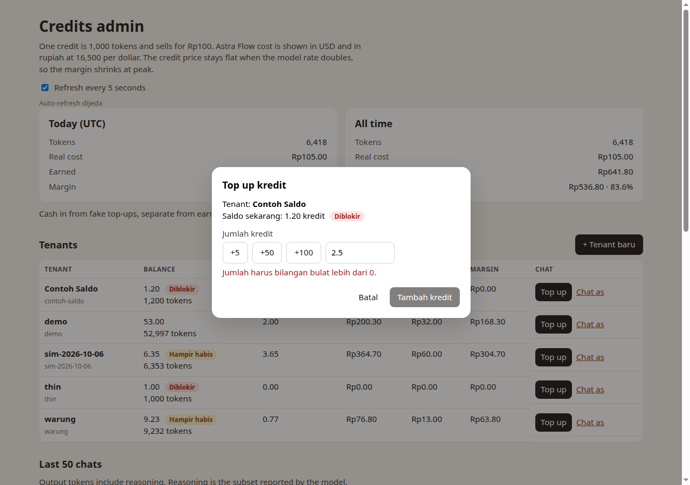

Crafted `POST /admin/topup` against `demo`, each with its own idempotency key, all returned 400 and left the balance unchanged:

| Amount | Error |
| --- | --- |
| empty | `Isi jumlah kredit.` |
| `0` | `Jumlah harus bilangan bulat lebih dari 0.` |
| `-3` | `Jumlah harus bilangan bulat lebih dari 0.` |
| `2.5` | `Jumlah harus bilangan bulat lebih dari 0.` |
| `10001` | `Maksimal 10.000 kredit per top up.` |

`POST /admin/tenant` with a blank name returned `Isi nama tenant.` A duplicate name `demo` returned `Nama tenant sudah dipakai.` The same two strings appeared inline in the create dialog before submit.

## 4. Double submit credits once

Two parallel `POST /admin/topup` calls for `demo` used the same idempotency key and `credits=5`. Both returned 200. Balance went from 52,997 tokens to 57,997 (delta 5,000, not 10,000). `credit_ledger` has one row for that key.

The in-memory unit test does the spec's +50 case: demo 50,000 → 100,000, one ledger row, both responses 303. The confirm button also disables and reads `Menambahkan…` as soon as the form submits, so a second click in the dialog shares that same hidden key.

## 5. Success banner and highlight

Creating `Warung Dialog` at 0 credits redirected with `POST` then `GET` (`303` / `location.assign` to `/admin?ok=created&tenant=warung-dialog`). The banner read:

`Tenant "Warung Dialog" dibuat · saldo 0 kredit.` plus a `Chat as` link.

The new row is first and highlighted. Reloading that URL is a GET, so it does not create the tenant again.

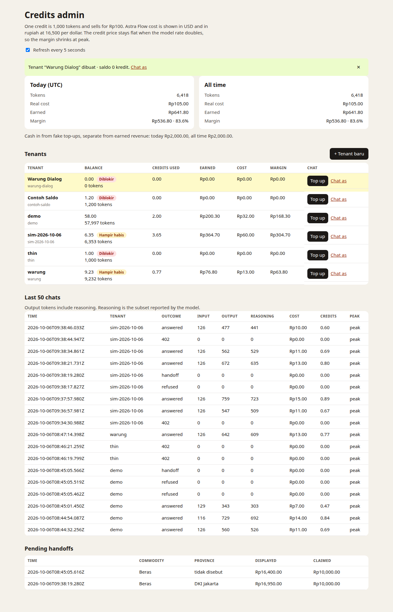

## 6. Auto-refresh pauses

The refresh is a `setInterval` of 5 seconds. There is no meta refresh. A counter in `sessionStorage` increments on each full load.

| Moment | Loads |
| --- | --- |
| Dialog just opened | 1 |
| 16 seconds later, dialog still open | 1 |
| 8 seconds after `Batal` | 2 |

`#refresh-paused` was not hidden, and the text `Auto-refresh dijeda` sits under the header checkbox.

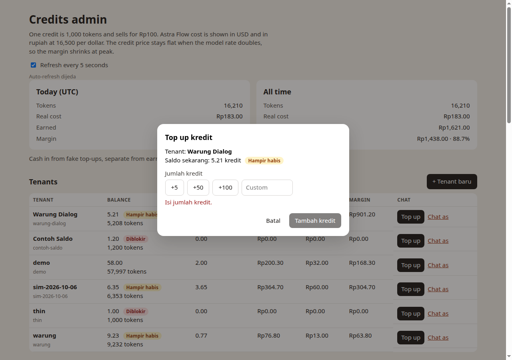

While admin stayed open on the second price answer, the Warung Dialog balance changed from `4.43 Hampir habis 4,434 tokens` to `3.71 Hampir habis 3,705 tokens` in 2,016 ms. `4,434 − 729 = 3,705`.

## 7. New tenant

The create dialog for `Contoh Saldo` at 0 showed `Preview: 0 kredit = 0 token = Rp0`. Empty name showed `Isi nama tenant.` Typing `demo` showed `Nama tenant sudah dipakai.`

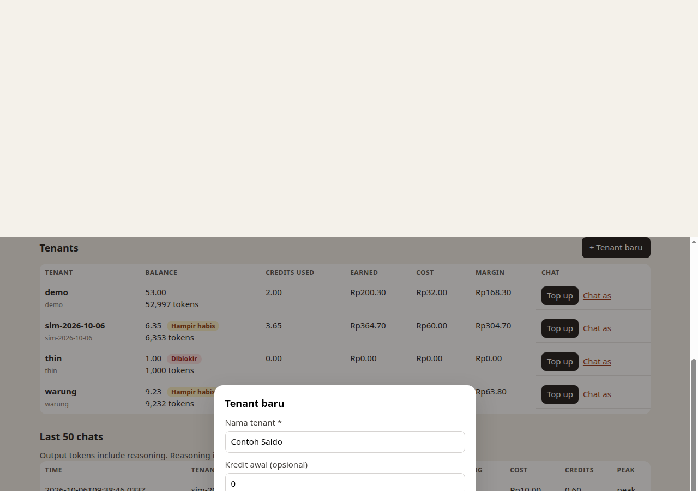

`Warung Dialog` was created at 0. Slug `warung-dialog` is derived from the name and shown under it. The row was at the top with balance 0 and `Diblokir`. `Chat as` points at `/?tenant=warung-dialog`.

## 8. Empty state

Preview D1 already has `demo`, so the live page cannot show zero tenants. `renderAdmin` with `tenants: []` contains `Belum ada tenant.`, `Buat tenant pertama untuk mulai mencoba chat.`, and `+ Tenant baru`. The unit test asserts those three strings. The screenshot below is that HTML rendered locally, 1280 wide.

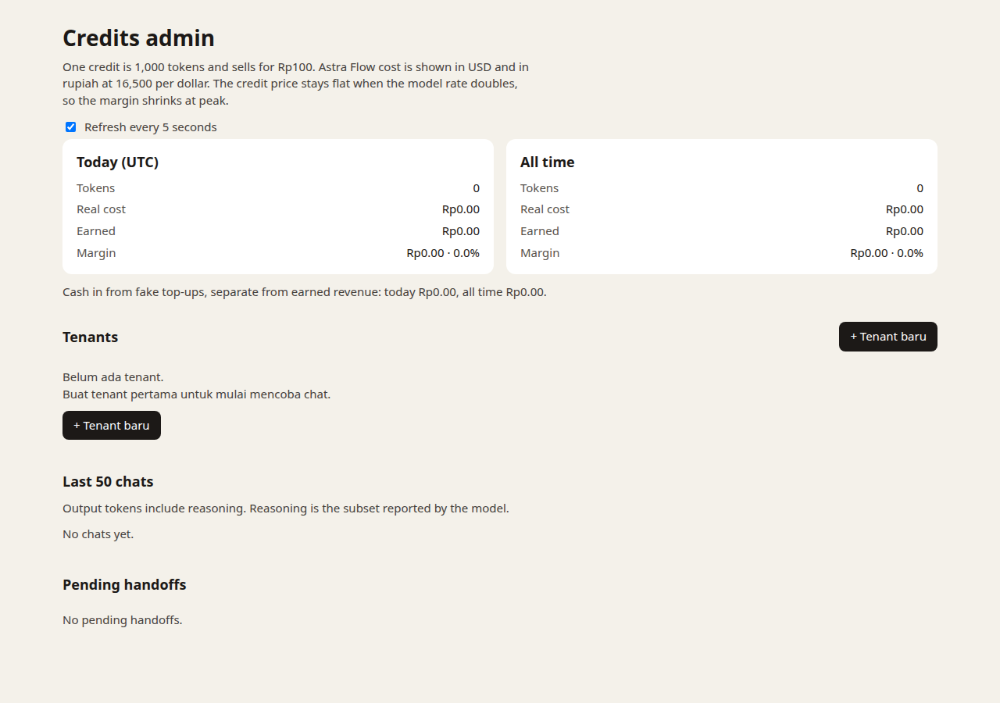

## 9. Badges

Live rows at the time of the badges shot:

| Tenant | Credits | Badge |
| --- | --- | --- |
| Contoh Saldo | 1.20 | Diblokir |
| thin | 1.00 | Diblokir |
| Warung Dialog | 6.07 | Hampir habis |
| sim-2026-10-06 | 6.35 | Hampir habis |
| warung | 9.23 | Hampir habis |
| demo | 58.00 | none |

The unit test pins the spec's exact cuts: 1,500 tokens render `1.50` + `Diblokir`, 5,000 tokens render `5.00` + `Hampir habis`, and 50,000 tokens render `50.00` with no badge element. `balanceBadge(1500) === "blocked"`, `balanceBadge(5000) === "low"`, `balanceBadge(50000) === null`.

## 10. Customer page has no billing words

`web/index.html`, `web/draft.js`, and `web/chat.css` do not match `\b(tokens?|kredits?|credits?|cost|sisa)\b`. The same check on the live `GET /`, `/draft.js`, and `/chat.css` was false for `token`, `kredit`, `credit`, `cost`, and `sisa`.

The clean reply shows the rice price as `16950` and the time `10.00`. It has no token line, no `$`, no `Rp`, and no `Sisa kredit`.

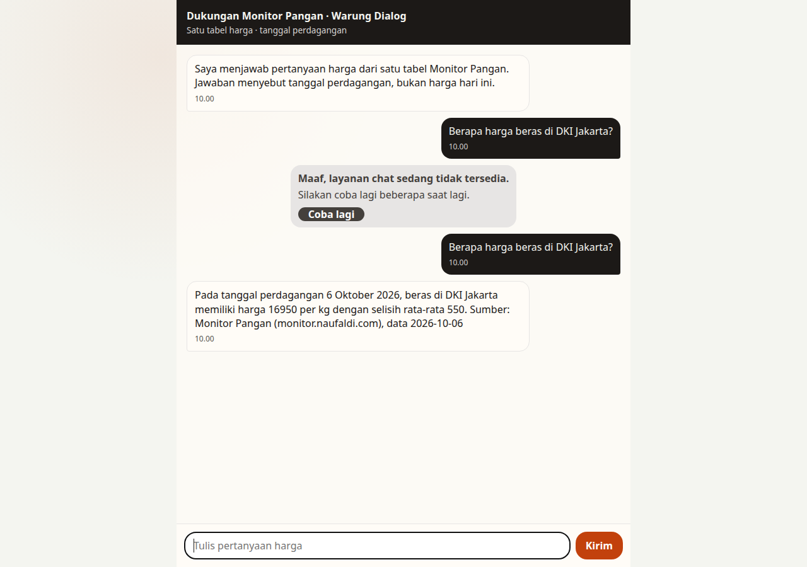

`rupiah()` in `draft.js` still prefixes a restored commodity fact with `Rp`. That is the food-price formatter. A later model sentence in the drain thread also wrote `Rp16.950` for the rice price. Neither is a credit or token line.

The public `POST /chat` JSON is `{ reply, draft, outcome }`. Usage is still stored in `request_usage` and charged on the ledger.

## 11. Header branding

`Dukungan Monitor Pangan · Warung Dialog`. The slug is not in the header. The word "tenant" is not on the customer page.

`GET /?tenant=does-not-exist` shows `Layanan ini tidak ditemukan.` The header stays `Dukungan Monitor Pangan`. No `request_usage` row was written between 10:01:28Z and 10:01:40Z, so that page made no model call.

English copies in the page script: `This service was not found.`, `Sorry, chat is temporarily unavailable.` / `Please try again in a moment.` / `Try again`.

## 12. Unavailable bubble

First send at 0 credits, `2026-10-06T10:00:25.620Z`. Outcome `402`, all token counts 0, `wording_ms` 0 (Astra Flow was not called). `price_read_ms` 1,274: the price table was read. The bubble text was:

`Maaf, layanan chat sedang tidak tersedia.`
`Silakan coba lagi beberapa saat lagi.`
`Coba lagi`

The composer stayed enabled.

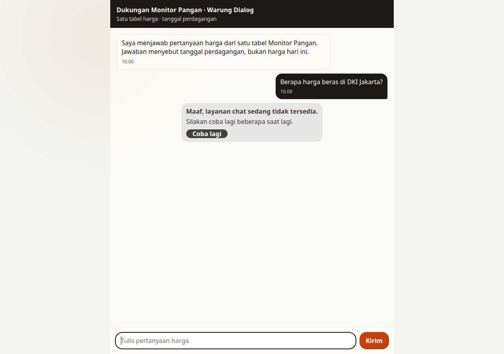

After the drain below, the next send at 1,298 tokens (`2026-10-06T10:05:47.325Z`) is the same bubble. Outcome `402`, 0 tokens, `wording_ms` 0, `price_read_ms` 1,052. The balance stayed 1,298.

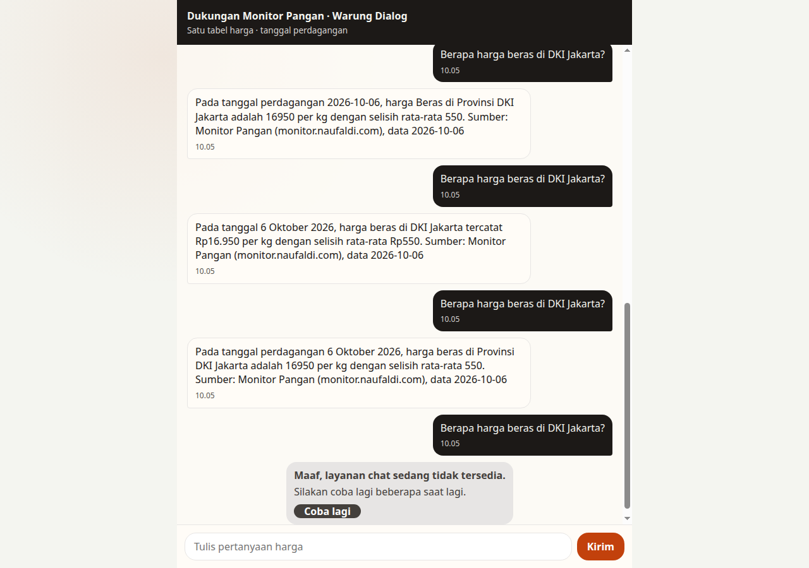

## 13. Top up, then Coba lagi

`+5` on Warung Dialog at 0 showed `+5 kredit = 5.000 token = Rp500` and `Saldo baru: 5.00 kredit`, button `Tambah 5 kredit`. The ledger `topup_fake` is +5,000 tokens at `2026-10-06T10:00:27.765Z`.

Five off-peak price answers then took the balance under 2 credits. Real replies include reasoning, so 5,000 tokens lasted five answers. The 2,000-token gate was not changed.

| UTC time | Prompt | Completion | Reasoning | Total charged | Balance after |
| --- | --- | --- | --- | --- | --- |
| 2026-10-06T10:00:27.940Z | 126 | 440 | 404 | 566 | 4,434 |
| 2026-10-06T10:00:37.739Z | 126 | 603 | 561 | 729 | 3,705 |
| 2026-10-06T10:00:50.496Z | 126 | 447 | 409 | 573 | 3,132 |
| 2026-10-06T10:00:57.627Z | 126 | 710 | 672 | 836 | 2,296 |
| 2026-10-06T10:01:11.570Z | 126 | 661 | 628 | 787 | 1,509 |

Refusal `How do I cook rice?` at `2026-10-06T10:00:48.618Z` and the claim at `2026-10-06T10:00:49.027Z` are 0 tokens. The balance stayed 3,705 across both.

A second `+5` and `Coba lagi` (the button resends the last message) answered at `2026-10-06T10:01:23.617Z`: 126 / 312 / 277 / 438 charged. A later pass, started at 6,071 tokens, reached 1,298 after seven price answers (722, 552, 566, 613, 781, 655, 884). Top-up preview at 1,298 tokens read `Saldo baru: 6.30 kredit`. The ledger went 1,298 → 6,298. `Coba lagi` then answered at `2026-10-06T10:05:51.504Z`: 126 / 964 / 927 / 1,090 charged, balance 5,208.

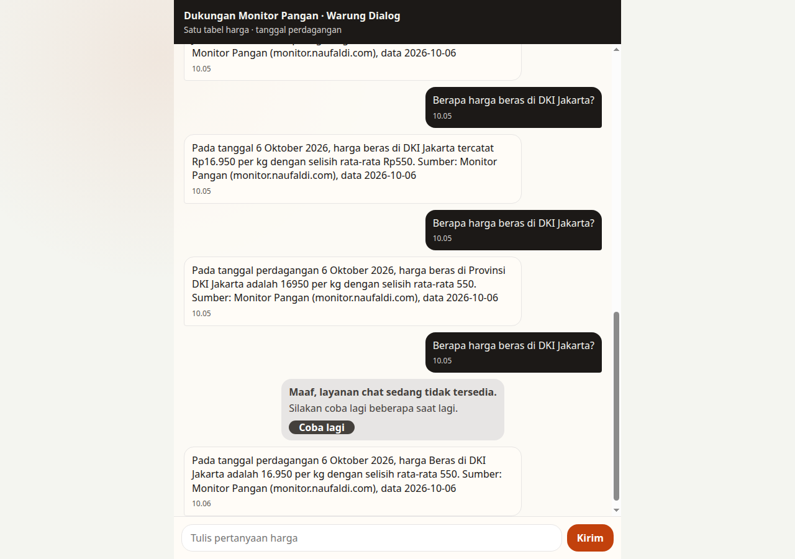

Admin, left open, showed the 729-token drop (4.43 → 3.71) in 2.0 seconds. After the last `Coba lagi`, `/admin` showed `5.21 Hampir habis 5,208 tokens` for `warung-dialog`, matching `6,298 − 1,090`.

## Books

Ledger sum equals balance for every tenant. Global gap is 0.

| Tenant | Balance before this QA | Balance after |
| --- | --- | --- |
| demo | 52,997 | 57,997 (the +5 double-submit test, credited once) |
| thin | 1,000 | 1,000 |
| warung | 9,232 | 9,232 |
| sim-2026-10-06 | 6,353 | 6,353 |
| contoh-saldo | created this run | 1,200 (the 1.20 preview fixture) |
| warung-dialog | created this run | 5,208 |

`contoh-saldo` and `warung-dialog` each match their own ledger sum.
